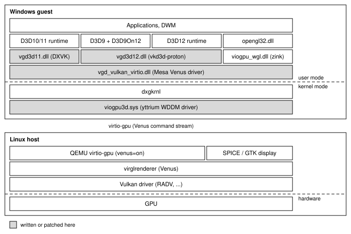

# virgl-win

Hardware-accelerated Direct3D 9/10/11/12, Vulkan and OpenGL for Windows guests in QEMU. Rendering runs on the host
GPU through Venus.


## How it works




- **DXVK and vkd3d-proton translate Direct3D to Vulkan.** `vgd3d11.dll` implements the D3D10/11 user-mode driver
  interface (DDI) on top of DXVK. `vgd3d12.dll` implements the D3D12 DDI on top of vkd3d-proton. D3D9 runs on Windows' own
  D3D9On12 adapter over `vgd3d12.dll`.
- **Venus takes the Vulkan calls to the host.** Mesa's Venus driver on guest's side encodes Vulkan calls into a command stream and submits to virtio-gpu. Vulkan applications reach it through the Vulkan loader, and OpenGL goes through Mesa's zink. virglrenderer on the host decodes the stream and replays it on the host's Vulkan driver.

- **yttrium's kernel driver makes virtio-gpu a WDDM device.** `viogpu3d.sys` is the Windows display miniport for
  virtio-gpu. It creates the Venus contexts, submits their command streams, manages blob resources and fences, and
  handles scanout, vsync and the cursor.

## Required configuration

### Host

Tested with QEMU 11.1.1 and virglrenderer 1.3.0 on RADV (AMD Strix Halo).

- QEMU with Venus support in virtio-gpu (the `venus` property). virglrenderer must be built with Venus
  (`-Dvenus=true`).
- A host Vulkan driver.

The virtio-gpu device needs `venus`, `blob` and a `hostmem` window:

```
-machine q35,memory-backend=mem
-object memory-backend-memfd,id=mem,size=8G,share=on
-device virtio-vga-gl,venus=on,blob=on,hostmem=4G
-display gtk,gl=on            # or SPICE with gl=on
```

With libvirt, which has no attribute for `venus`, set it through an override on the video device:

```xml
<memoryBacking>
  <source type='memfd'/>
  <access mode='shared'/>
</memoryBacking>
...
<graphics type='spice'>
  <listen type='none'/>
  <image compression='off'/>
  <jpeg compression='never'/>
  <zlib compression='never'/>
  <playback compression='off'/>
  <streaming mode='off'/>
  <mouse mode='server'/>
  <gl enable='yes' rendernode='/dev/dri/renderD128'/>
</graphics>
<video>
  <model type='virtio' heads='1' primary='yes' blob='on'>
    <acceleration accel3d='yes'/>
  </model>
</video>
...
<qemu:override>
  <qemu:device alias='video0'>
    <qemu:frontend>
      <qemu:property name='venus' type='bool' value='true'/>
      <qemu:property name='hostmem' type='unsigned' value='4294967296'/>
    </qemu:frontend>
  </qemu:device>
</qemu:override>
```

For lower input latency, we recommend virtio input devices in place of the emulated PS/2 and USB ones (the guest
needs virtio-win's `vioinput` driver). If convenient, also avoid virt-manager and spice display, in favor of QEMU GTK window.


### Guest

- Windows 11, x64. Tested on 25H2.
- Secure Boot off and test signing on (`bcdedit /set testsigning on`). Or you buy me a Windows driver certificate.

## Building and installing

Everything builds on a Linux host inside `nix develop` (see `flake.nix`):

```
cmake -S . -B build/win -G Ninja -DCMAKE_TOOLCHAIN_FILE=cmake/mingw-w64.cmake && cmake --build build/win
icd/build.sh
cmake -S kmd -B build/kmd -G Ninja -DCMAKE_TOOLCHAIN_FILE=cmake/clang-cl-kmd.cmake && ninja -C build/kmd
```

The WDK and SDK headers come from Microsoft's NuGet packages (Microsoft.Windows.WDK.x64 and
Microsoft.Windows.SDK.CPP, 10.0.26100), extracted into `refs/winkits/{wdk,sdk}`.

To install, make `build/` visible in the guest and run this from an elevated PowerShell in `build\win\tests\win`:

```
powershell -ExecutionPolicy Bypass -File .\vgd-test.ps1 Install
```

Then reboot. Take a VM snapshot first: DWM loads `vgd3d11.dll` as soon as the package is installed. The comment at
the top of `vgd-test.ps1` covers Uninstall and recovery.

## Status

Work in progress. GravityMark's D3D12, OpenGL and Vulkan benchmarks work, D3D11 lacks a rasterization feature in DXVK. WebGL examples in Edge browser should work. UI should be flawless most of the time but intermittent stuttering may occur.
 
## Thanks

- **[yttrium](https://github.com/arehnman/yttrium-virtio-gpu)** by arehnman: the WDDM kernel driver for
  virtio-gpu, the Mesa fork that runs Venus on Windows, the resolution service, and QEMU and virglrenderer fixes for
  Windows guests. Our kernel driver and Vulkan/OpenGL drivers are yttrium's, built here with a few patches.
- **[DXVK](https://github.com/doitsujin/dxvk)** by Philip Rebohle and contributors: all of D3D10/11 here is DXVK.
- **[vkd3d-proton](https://github.com/HansKristian-Work/vkd3d-proton)** by Hans-Kristian Arntzen and contributors:
  all of D3D12 here is vkd3d-proton.

Also Mesa (Venus, zink), virglrenderer and QEMU, which do the work on both sides of the virtio-gpu link.
